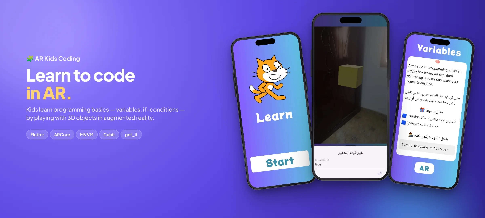
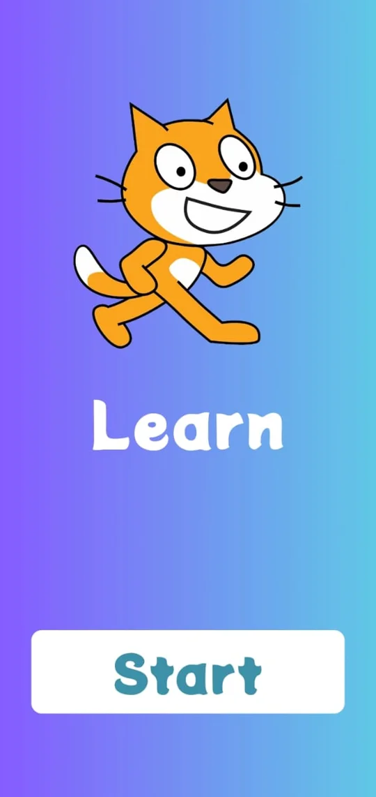
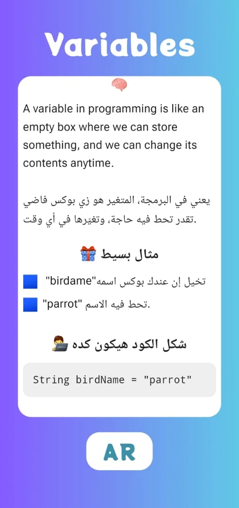
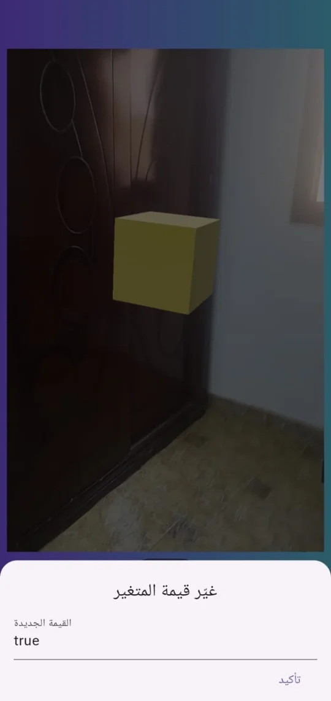
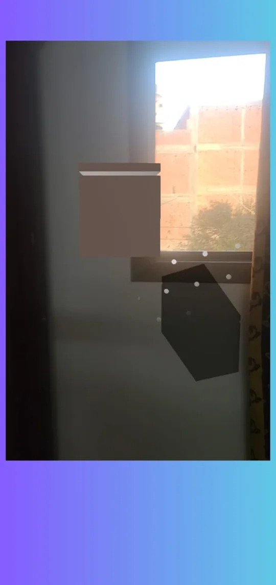
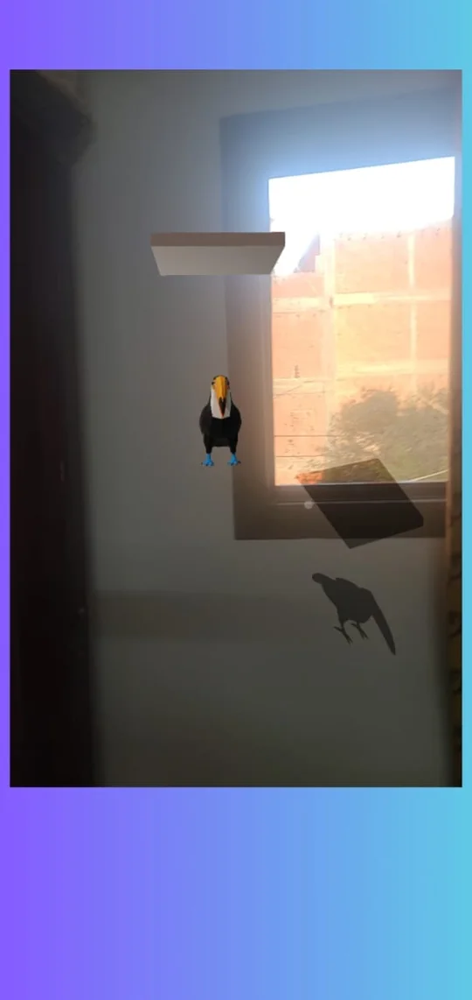
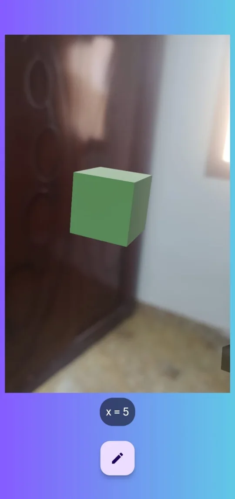

<h1 align="center">🧩 AR Kids Coding</h1>

<p align="center">
  An <b>Augmented Reality</b> Flutter app that teaches kids the basics of programming
  by playing with real 3D objects around them.
</p>

<p align="center">
  
  
  
  
  
</p>

<p align="center">
  
</p>

## 📱 Screens

| Start | Variables | AR scene |
|:-:|:-:|:-:|
|  |  |  |

| Variable in AR | 3D objects | If condition |
|:-:|:-:|:-:|
|  |  |  |

## 💡 The idea

Abstract ideas like *variables* and *if conditions* are hard for kids.
So the app turns them into things they can **see and touch** through the camera:

| Lesson | In AR |
|---|---|
| **Programming** | A short explanation (English + Egyptian Arabic) and a video. |
| **Variables** | A variable is a **box**. Tap it, the lid opens, and the value inside (a 🦜 3D toucan) appears. |
| **If condition** | Type any value — the box **changes colour** by its type: 🟢 number · 🔵 text · 🟡 true/false · ⚪ anything else. |

## 🏗️ Architecture — MVVM

```
lib/
├── core/
│   ├── ar/            # ArSceneService — the only place that talks to ARCore
│   ├── di/            # get_it service locator
│   ├── routing/       # go_router + route names
│   ├── services/      # PermissionService (camera)
│   ├── theme/         # colors, decorations, text styles
│   └── widgets/       # shared UI: LessonScaffold, ArViewFrame, LessonCard…
└── features/
    ├── onboarding/
    ├── home/
    ├── programming/   # data → view_model (video cubit) → views
    ├── variables/     # data → view_model (box cubit)   → views
    └── if_condition/  # domain (VariableValue) → view_model → views
```

- **View** — stateless widgets, they only render state and forward events.
- **ViewModel** — a `Cubit` per AR screen that holds the state and decides *what* to draw.
- **Service** — `ArSceneService` knows *how* to draw it with ARCore, so view models never touch the native controller.
- **Dependency Injection** — services are registered once in `get_it` and injected into view models through their constructors, which makes them easy to fake in tests.
- **Lesson content** lives in `data/` files, not inside widgets.

## 🧪 Tests

The `if` logic and the view model are covered by unit tests with fake services (no device needed):

```bash
flutter test
```

## 🚀 Run it

> ARCore needs a real Android device that supports [Google Play Services for AR](https://developers.google.com/ar/devices).

```bash
flutter pub get
flutter run
```

## 🧰 Tech

Flutter · `arcore_flutter_plugin` · `flutter_bloc` (Cubit) · `get_it` · `go_router` · `flutter_screenutil` · `video_player` + `chewie` · `permission_handler`

---

<p align="center">Made with ❤️ by <a href="https://github.com/youssef-hossam">Youssef Hadwa</a></p>
